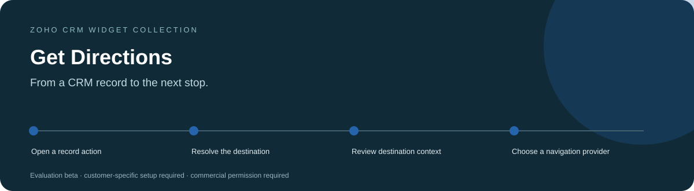
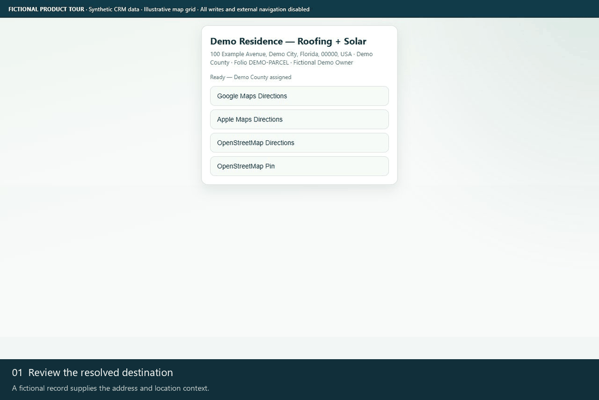
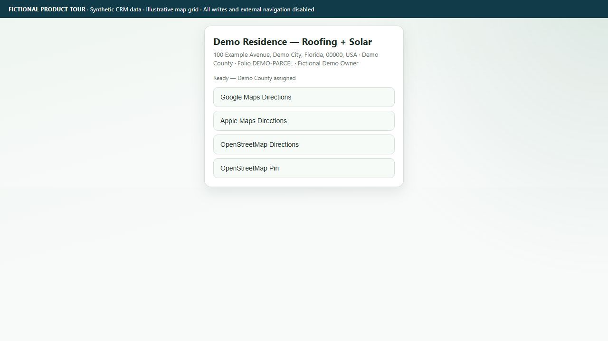
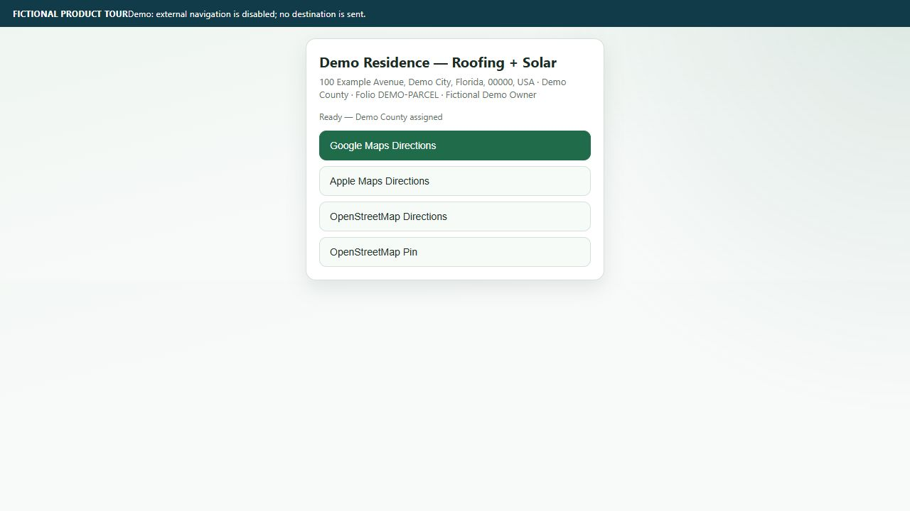
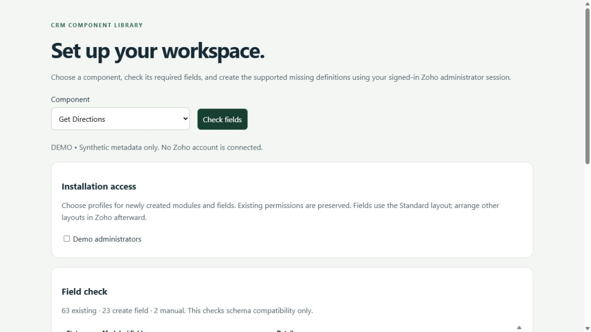

<h1 align="center">Get Directions for Zoho CRM</h1>

<strong>From a CRM record to the next stop.</strong> A compact CRM companion that resolves a record's destination and offers Google Maps, Apple Maps and OpenStreetMap direction links.

Tested &amp; In Development / Pre-Release · Development showcase and fictional-data tours

> **Tested & In Development / Pre-Release.** Testing covers documented development checks only. Production readiness and customer-specific acceptance remain pending.

> [!IMPORTANT]
> **Showcase only.** This public repository contains product information and fictional demonstration media. It provides no software source, installable packages, free beta downloads or software license. Release availability remains pending; any future deployment scope will be agreed privately. Product validation and the limitations below still apply.

[Discuss a commercial installation](https://github.com/RawPowered/Zoho-Get-Directions/issues/new?template=commercial-inquiry.yml) · [Deployment model](DEPLOYMENT.md) · [Commercial terms overview](COMMERCIAL.md)

## A focused workspace

Teams that need a consistent navigation handoff from sales and service records.

| Capability | What it helps with |
| --- | --- |
| **A resolved destination** | Use saved CRM coordinates or resolve a configured address. |
| **Provider choice** | Choose Google Maps, Apple Maps or OpenStreetMap without storing a mapping API key in the widget. |
| **Context before travel** | Show available county and parcel information beside the destination. |

## Product tour

These captures show the actual widget running against an isolated fictional-data adapter. No customer account, real person, customer branding or production credential is used. CRM writes and outbound navigation are blocked. Map backgrounds are illustrative grids; required third-party attribution is retained.

### Watch the workflow

The animation is a sequence of actual interface states, held for readability. It is not a recording of a live customer installation.

### Start with the workspace

A fictional record supplies the address and location context.

### Follow the next actions

<table><tr><td width="50%"><strong>Choose a navigation action</strong>
The demo blocks external navigation; no destination is sent.
</td><td width="50%"><strong>Review the field requirements</strong>
The setup preview distinguishes existing, missing and manual definitions.
</td></tr></table>

### Prepare the account deliberately

A separately licensed Schema Setup companion can be scoped to this product. It reads field metadata, identifies compatible existing definitions, and distinguishes missing definitions from manual steps. A field plan does not certify that functions, workflows or permissions are complete.

All records and sample labels are fictional. Preview tooling and installable software are not distributed through this public showcase. Commercial deployment still requires the documented account-specific acceptance checks.

## Commercial deployment

Licensed widget packages are supplied privately for the agreed customer organization. An authorized administrator installs them directly inside Zoho CRM using **Zoho internal hosting**, sets the supplied entry page and attaches the intended CRM placement. A record button with Lead, Contact, Account or Deal context.

Schema, access profiles, workflows and service connections are reviewed for the licensed installation. A showcase screenshot does not certify compatibility or complete those steps. WordPress integration, where licensed, runs on the customer's live WordPress host and is configured separately. [How the platforms fit together](DEPLOYMENT.md).

## Data access and responsibilities

**Reads:** The active Deal, Lead, Contact or Account and its mapped address, coordinates and county/parcel context.

**Writes:** Opening this widget calls location, county and parcel synchronization. Depending on the record and configuration, it can save coordinates, create county reference records, assign counties and save Deal parcel fields. It is not only a link generator.

**External services:** Nominatim geocoding, selected regional public GIS services and the chosen navigation provider. Navigation links include a destination address or coordinates.

## Current product boundaries

- County/parcel enrichment depends on regional coverage and provider availability.
- Missing address formulas or multi-select county relationships are manual schema steps.
- This widget opens navigation links; it does not provide a routing engine or guarantee travel times.

Status: **Tested & In Development / Pre-Release**. Account-specific acceptance is required before production activation. Credentials and customer data are configured privately in the customer environment.

## Commercial availability

Request licensing, installation, account mapping or support through a [commercial inquiry](https://github.com/RawPowered/Zoho-Get-Directions/issues/new?template=commercial-inquiry.yml). Include only a general use case; public issues must not contain customer records, account IDs, secrets or confidential details. Pricing, permitted organizations/users, delivery scope and support terms are agreed privately. This page does not collect payment or grant permission to use the software.

## Explore the collection

[Widget collection](https://github.com/RawPowered/Zoho-CRM-Widgets) · [Automation overview](https://github.com/RawPowered/Zoho-CRM-Automations) · [PowerPortals](https://github.com/RawPowered/PowerPortals-Showcase)

- [Service Map](https://github.com/RawPowered/Zoho-Service-Map)
- [Service Map Dashboard](https://github.com/RawPowered/Zoho-Service-Map-Dashboard)
- [CEO Pipeline](https://github.com/RawPowered/Zoho-CEO-Pipeline)
- [Project Scoper](https://github.com/RawPowered/Zoho-Project-Scoper)
- [Parts and Scope Builder](https://github.com/RawPowered/Zoho-Parts-and-Scope-Builder)
- [Project Task Builder](https://github.com/RawPowered/Zoho-Project-Task-Builder)
- [Financial Scope](https://github.com/RawPowered/Zoho-Financial-Scope)
